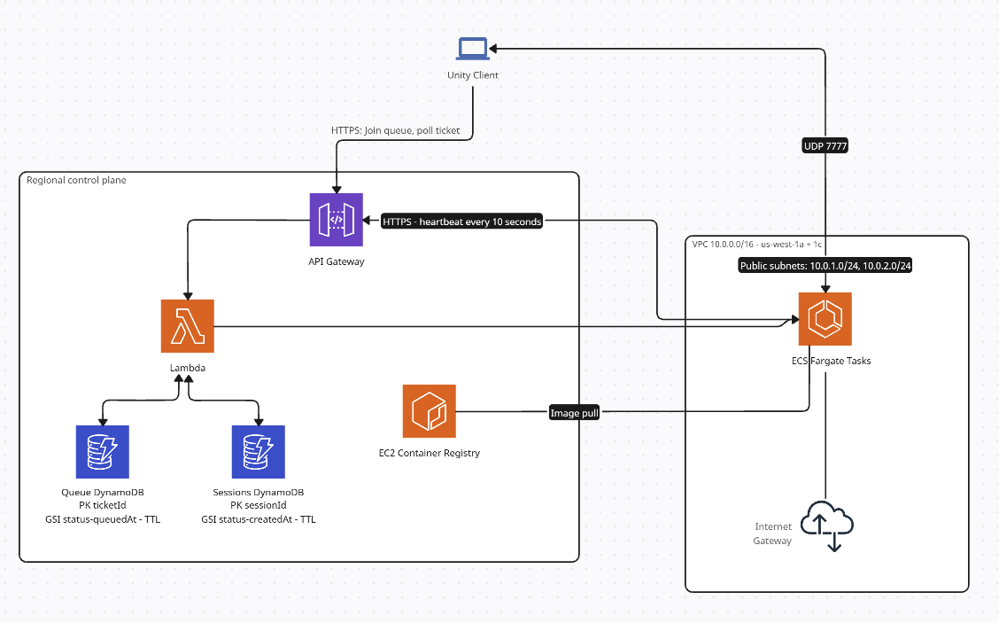

# Custom AWS Matchmaker

Cloud infrastructure for an on-demand multiplayer game backend. Players hit
"Find Match"; a dedicated game server is provisioned on AWS Fargate only once
there are enough players for a match, and it terminates itself when the match
is over.

Nothing runs when nobody is playing. Idle cost is under ten cents a month.

---



The dotted UDP line is the important one: **API Gateway is control plane only.**
It answers "where do I go?" once, then the client talks straight to the Fargate
task. Gameplay traffic never touches the API. It couldn't, since API Gateway
is HTTP and this is a 20 Hz UDP game loop.

### Resource inventory

| Service         | Resource                              | Notes                                                                                                   |
| --------------- | ------------------------------------- | ------------------------------------------------------------------------------------------------------- |
| **VPC**         | `ground-trace-vpc` 10.0.0.0/16        | 2 public + 2 private subnets across `us-west-1a` / `1c`; AZs resolved by data source, not hardcoded     |
|                 | Security group                        | Inbound UDP 7777 from `0.0.0.0/0` — clients connect from arbitrary residential IPs                      |
|                 | _(no NAT gateway)_                    | Deliberate; see design notes                                                                            |
| **ECR**         | `ground-trace-game-server`            | Scan-on-push, lifecycle policy keeps 5 images                                                           |
| **ECS**         | `ground-trace-cluster`                | Fargate only, Container Insights enabled                                                                |
|                 | Task definition rev 4                 | 512 CPU / 1024 MB, `awsvpc`, UDP 7777, env-configured                                                   |
| **Lambda**      | `ground-trace-matchmaker`             | `python3.13`, 256 MB, boto3 only — no dependencies to package                                           |
|                 | `ground-trace-ecs-events`             | Same zip, 128 MB. Ends sessions and reports billed time when a game server task stops                    |
| **EventBridge** | `ground-trace-game-server-stopped`    | ECS task state changes, `STOPPED` only, game server cluster only → `ecs-events`                         |
| **API Gateway** | HTTP API (v2)                         | `POST /queue`, `GET·DELETE /queue/{ticketId}`, `POST /sessions/{id}/heartbeat`, `DELETE /sessions/{id}` |
| **DynamoDB**    | `ground-trace-queue`                  | PK `ticketId`, GSI `status-queuedAt-index`, TTL on `expiresAt`, on-demand                               |
|                 | `ground-trace-sessions`               | PK `sessionId`, GSI `status-createdAt-index`, TTL on `expiresAt`, on-demand                             |
| **CloudWatch**  | `/ecs/ground-trace-game-server`       | 7-day retention                                                                                         |
|                 | `/aws/lambda/ground-trace-*`          | Logs for both functions, 7-day retention                                                                |
|                 | Container Insights                    | Per-task CPU/memory metrics                                                                             |

### IAM

Four roles, each scoped to exactly what assumes it:

| Role                              | Trusted by                | Grants                                                                                                                                                                           |
| --------------------------------- | ------------------------- | -------------------------------------------------------------------------------------------------------------------------------------------------------------------------------- |
| `ground-trace-ecs-task-execution` | `ecs-tasks.amazonaws.com` | Managed `AmazonECSTaskExecutionRolePolicy` — pull from ECR, write logs. Used by the ECS agent, never by game code.                                                               |
| `ground-trace-game-server-task`   | `ecs-tasks.amazonaws.com` | **Nothing.** The game server makes no AWS API calls, so it holds no permissions. Defined so adding one later is a policy change, not a restructure.                              |
| `ground-trace-matchmaker`         | `lambda.amazonaws.com`    | DynamoDB read/write on both tables **and their indexes**, `ecs:RunTask`/`DescribeTasks`/`StopTask`, `ec2:DescribeNetworkInterfaces`, `iam:PassRole` scoped to the two task roles |
| `ground-trace-ecs-events`         | `lambda.amazonaws.com`    | `dynamodb:DeleteItem` on the sessions table. Nothing else: it can't read the queue or launch tasks                                                                               |

Two details in the matchmaker row are the ones people get wrong:

- **A GSI is a separate ARN from its table.** Granting `Query` on
  `table/ground-trace-sessions` does not permit querying
  `status-createdAt-index`; the policy needs `table/.../index/*` as well.
- **`iam:PassRole` is distinct from `ecs:RunTask`.** Launching a task means
  handing it two roles, and IAM treats "may I give this role to a service?" as
  its own permission. Granting only `RunTask` produces an AccessDenied that
  reads like the RunTask permission is missing.

### Flow

1. Client `POST /queue` → a ticket row in DynamoDB. No server exists yet.
2. Every join, and every poll of a waiting ticket, re-evaluates the queue. Once
   enough players are waiting, their tickets are claimed atomically and a
   server is provisioned or an existing server with a free slot is reused.
3. Client polls `GET /queue/{ticketId}` → `waiting` → `provisioning` → `matched`
   with an `{ip, port}`.
4. Client connects directly over UDP. The game's own lobby confirms both
   players actually arrived before starting.
5. The server heartbeats its state every 10s. When the last player leaves, it
   exits, which stops the task and ends billing. The task's `STOPPED` event
   removes its session row and records how long it was billed for.

---

## Layout

```
infrastructure/aws/
  main.tf, variables.tf, output.tf
  vpc.tf          VPC via terraform-aws-modules, no NAT gateway
  ecr.tf          image repository + lifecycle policy
  ecs.tf          Fargate cluster, task definition, security group
  dynamodb.tf     queue + sessions tables, both with GSI and TTL
  iam.tf          task execution / task / matchmaker / ecs-events roles
  lambda.tf       both functions, packaged together by archive_file
  ecs_events.tf   EventBridge rule: game server tasks stopping -> ecs-events
  apigateway.tf   HTTP API, routes, throttling
  dashboard.tf    CloudWatch dashboard and alarms
  lambda/
    matchmaker/   everything in here ships
      handler.py      API entry point: auth, routing, errors
      ecs_events.py   EventBridge entry point
      mm/             tickets, matching, sessions, backends/
    tests/        pytest + moto; never shipped
docs/             research notes and plans
scripts/
  run-server.sh   launch one server by hand and print its address
```

---

## Design decisions

### Nothing waits inside a running server

The obvious design is "first player starts a server and waits in it." That
means paying for a container while someone sits alone in a lobby, potentially
for as long as they're willing to wait.

Instead, waiting happens in a DynamoDB row. A server is provisioned at the
moment a match forms. The cost is that both players then wait through a 30–60
second cold start together, rather than the second player arriving to a warm
server.

Production games solve this with **warm pools**, Agones and GameLift both
manage fleets of idle, pre-booted servers so allocation is instant. That trades
continuous spend for latency. At this scale the trade runs the other way.

### The server decides when it's finished

Nothing external reaps a Fargate task. ECS will happily run an empty game
server forever and bill for it. So the server terminates itself once it's been
empty for a configurable window, which stops the task and ends the charge.

Scale-to-zero isn't something the infrastructure does to the workload, the
workload has to participate.

### TTL is garbage collection; age is correctness

Both tables carry a DynamoDB TTL, but TTL is explicitly best-effort: AWS only
promises deletion "within a few days," and until then expired items still come
back from reads, queries and scans. A server that dies without deregistering
leaves a row that still looks joinable.

So liveness is decided by age, not by TTL. Observed in practice: a session row
advertised a dead server for **139 seconds** before TTL removed it. Anything
trusting TTL alone would have routed a player to an address with nothing on it.

The same rule applies to tickets. Each poll records `lastSeenAt` and pushes the
ticket's expiry forward, so:

- a player whose client stopped polling for 10 seconds is a ghost, and is
  never matched — otherwise a real player could be paired with nobody, and a
  server launched for one person;
- a player who is still polling is never expired, however long they wait;
- a ticket nobody has polled for five minutes reads as `expired`, whether or
  not TTL has deleted it yet.

### Matching is level-triggered

Matching evaluates the queue as it stands and does whatever is possible right
now — and it runs on every poll of a waiting ticket, not just on join.

Run only on join, it missed every way a match becomes possible without a new
player arriving: a server stopping and freeing capacity, an opponent leaving
and opening a backfill slot, claims released after a lost race or a failed
launch. Players already waiting sat there until someone new showed up. It
could even miss the ordinary case: the joining player's own ticket reaches the
GSI asynchronously, so the query run milliseconds after writing it can come
back without it.

Clients poll every two seconds anyway, so the polls are the clock. Nothing runs
on a timer, and nothing runs while nobody is waiting. Matching failures are
logged and counted, but never fail the join or poll that triggered them — the
next poll retries.

### Concurrent matchers can't double-claim

With every join and poll able to trigger matching, several invocations
regularly see the same waiting tickets at once. Each ticket is claimed with a
conditional `UpdateItem` (`status` must still be `waiting`), so exactly one
invocation wins; the loser rolls back its claims and leaves its players queued.

Optimistic concurrency, no locks, no coordination service.

The server cap is a check-then-act — count sessions, then `RunTask` — so two
invocations claiming *different* pairs at the same moment can both pass it.
The overshoot is bounded by how many disjoint full matches are waiting at
once. A true hard cap needs an atomic counter; that's a deliberate
non-goal at this scale.

### A session row lives exactly as long as its task is billed

The row is written right after `RunTask` succeeds, and deleted by the
`ecs-events` function the moment ECS reports the task `STOPPED` — whatever
stopped it: a normal exit, a crash, an OOM kill, `StopTask`. That's the span
Fargate bills for, so counting rows counts exactly the servers being paid for,
and the cap frees up within seconds of a server ending rather than whenever TTL
gets around to it.

The game server never deregisters itself: an HTTP call fired while the process
is exiting rarely completes. The `STOPPED` event is the one reliable signal.

ECS delivers events at least once. The delete is conditional on the row
existing, so only the first delivery gets the row back, and only that one
reports `TaskBilledSeconds`.

### No blind upserts

`UpdateItem` creates the item if the key doesn't exist. Every update to a row
that something else may have deleted — a heartbeat, a cached IP, a ticket
being stamped or kept alive — is conditional on the row existing.

The heartbeat is the one that mattered. Unconditional, it let anyone holding
the game client's (extractable) API key create sessions out of made-up ids, and
since sessions count toward the server cap, a handful of requests stopped all
matchmaking. Unknown sessions now get a 404.

### Provisioning never blocks

`RunTask` is called and the request returns immediately with
`status: provisioning`. The client polls until an address appears.

This isn't only elegance: **API Gateway caps integrations at 29 seconds**, and
a Fargate cold start routinely exceeds that. A synchronous design would have
been architecturally doomed rather than merely slow.

### Polling drives IP resolution

A Fargate task cannot discover its own public IP — the address lives on the ENI,
outside the container, and Fargate has no EC2 instance metadata endpoint.
Someone outside has to look it up.

Rather than run a poller on a timer, the client's own status request does it:
if a matched session has no address yet, that request performs the
`DescribeTasks` → `DescribeNetworkInterfaces` lookup and caches the result. No
timer, no idle compute.

### Backfill before provisioning

If a live server already has a free slot — someone quit a 1v1 and the match was
abandoned back to its lobby, a single queued player joins it rather than
triggering a second container. Cheaper and faster than a cold start.

### Two IAM roles, not one

- **Task execution role**: assumed by the ECS agent to pull the image and ship
  logs. The application never uses it.
- **Task role**: assumed by the server process itself. Deliberately empty: the
  game server makes no AWS API calls, so it gets no permissions.

Keeping the second role defined-but-empty means adding a permission later is a
policy change, not a restructure.

---

## Cost

|             |                                                                             |
| ----------- | --------------------------------------------------------------------------- |
| Idle        | **< $0.10/month** — ECR storage, a few DynamoDB rows, log retention         |
| Per match   | **~$0.03/hour** — one Fargate task at 0.5 vCPU / 1 GB (`us-west-1`)         |
| Matchmaking | Effectively free — Lambda and API Gateway are per-request at trivial volume |

A ten-minute match costs about half a cent. The single largest cost decision
was deleting one line of Terraform (`enable_nat_gateway`), which was worth more
than every other optimization combined.

### Cost controls

- Servers self-terminate when empty
- `max_concurrent_sessions` caps how many tasks can exist at once, which bounds
  worst-case spend regardless of who is calling the API
- API Gateway throttling (10 req/s, burst 5)
- ECR lifecycle policy expires old images
- Game server logs have a 7-day retention rather than the never-expire default
- An AWS Budgets alarm as the backstop

Container Insights is currently enabled, which publishes per-task CPU and memory
metrics and bills for them. It's on to gather right-sizing numbers; leaving it
off is the cheaper steady state once the task is sized.

---

## Running it

Requires Terraform, the AWS CLI, and Docker.

```bash
cd infrastructure/aws
terraform init
terraform apply          # needs matchmaker_api_key in terraform.tfvars
```

Then build the Unity Linux dedicated server, and from the game repo:

```bash
aws ecr get-login-password --region us-west-1 \
  | docker login --username AWS --password-stdin <account>.dkr.ecr.us-west-1.amazonaws.com
docker build -f Dockerfile.server -t game-server .
docker tag game-server:latest <account>.dkr.ecr.us-west-1.amazonaws.com/ground-trace-game-server:latest
docker push <account>.dkr.ecr.us-west-1.amazonaws.com/ground-trace-game-server:latest
```

`terraform output matchmaker_api_url` gives the endpoint the game client needs.

To launch a server by hand without going through matchmaking:

```bash
bash scripts/run-server.sh
```

It resolves networking by tag, launches one task, waits for `RUNNING`, and
prints the address. The manual version of what the matchmaker automates.

### Tests

The Lambda code has a pytest suite that runs against
[moto](https://github.com/getmoto/moto) — no AWS account or credentials
needed. CI runs it on every change under `infrastructure/aws/lambda/`.

```bash
cd infrastructure/aws/lambda
python -m venv .venv && .venv/bin/pip install -r requirements-dev.txt   # .venv\Scripts\ on Windows
.venv/bin/python -m pytest
```

On Windows, put the venv at a short path if `pip` fails with a "No such file"
error: moto's nested package layout can exceed the 260-character path limit.

## State backend

Terraform state lives in a versioned, encrypted S3 bucket with public access
blocked. Versioning is the point: a corrupted or badly-applied state can be
rolled back to a previous object version.

Locking uses **S3-native conditional writes** (`use_lockfile = true`) rather
than a DynamoDB lock table. The DynamoDB pattern that most guides still show
was deprecated in Terraform 1.11 and is slated for removal — S3 gained
conditional write support, so the separate table is no longer needed.

The bucket is created out-of-band rather than by Terraform, since a bucket
can't sensibly bootstrap the state file that describes it.

## CI/CD

GitHub Actions runs `terraform plan` on pull requests (posting the plan as a
PR comment) and `terraform apply` on merges to `main`.

**No AWS credentials are stored anywhere.** The workflow federates into an IAM
role via GitHub's OIDC provider: Actions presents a short-lived token
describing which repository and ref is running, and STS exchanges it for
temporary credentials. Nothing to rotate, nothing to leak from repository
secrets.

Two details worth recording, because most published examples get them wrong:

**The subject claim contains immutable numeric IDs.** The real `sub` looks
like `repo:DrewCoding@122519034/ground-trace@1345255887:ref:refs/heads/main`,
not the `repo:owner/name:*` form every guide shows. Pinning those IDs is
what makes the trust rename-proof: a repository that is renamed, or deleted
and recreated by someone else under the same name, gets a different ID and
silently stops matching.

**The provider ARN is derived, not looked up.** Using a
`aws_iam_openid_connect_provider` data source requires
`iam:ListOpenIDConnectProviders`, which `PowerUserAccess` does not grant - and
granting it is circular, since the policy conferring the permission would
reference the data source needing that permission to be read. The ARN is
deterministic from the account ID and the provider URL, so constructing it
avoids both the extra permission and the dependency cycle.

Related: `PowerUserAccess` is `NotAction: ["iam:*", ...]` plus a short
allowlist, so it grants almost nothing in IAM. Every IAM action this project
needs is enumerated explicitly and scoped to the `ground-trace-*` prefix.

## Up Next

- Frontend live monitoring tickets and containers
- CI/CD pipeline for client and server builds
- Cognito for authenticated queue tickets
